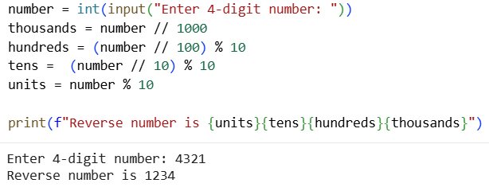
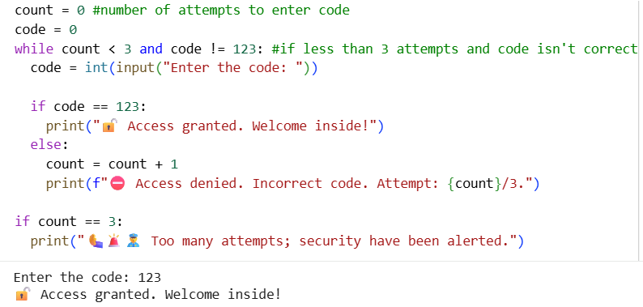

# Python Basics - Data Technician Bootcamp

## 📌 Overview
This repository contains my completed practical exercises for **Week 6 (Python Basics - Day 1 & Day 2)** of the Data Technician bootcamp. The work covers core programming fundamentals, including variables, input/output, type casting, conditional branching, and loops.

## 🔗 Google Colab Notebooks
* **Day 1 Exercises**: [Access Notebook via Colab](https://colab.research.google.com/drive/1BxtUCpDHDO9KsTLEtpWeJCz7_7IWIdez?usp=sharing)
* **Day 2 Exercises**: [Access Notebook via Colab](https://colab.research.google.com/drive/1lU_-rLedrmLX2mFJ_HNMnnknjyPF_r2K?usp=sharing)

---

## 🛠️ Key Skills & Concepts Covered
1. **Variables & Data Types**: Storing strings, integers, and floats securely following standard naming practices.
2. **Input/Output Operations**: Utilizing `print()` for console outputs and `input()` for dynamic user interactions.
3. **Type Conversion (Type Casting)**: Explicitly transforming string inputs into integers or floats for accurate mathematical evaluations.
4. **Conditional Logic**: Implementing `if`, `elif`, and `else` statements to handle branching workflows based on dynamic user parameters.
5. **Loops**: Automating repetitive tasks and scanning sequences using `for` and `while` loops.

---

## 💻 Featured Implementation: 

### 1. FizzBuzz Challenge
As part of Day 2 tasks, I implemented the classic **FizzBuzz** algorithm using loops and conditional structures to process integers from 1 to 100:

```python
for i in range(1, 101):
    if i % 3 == 0 and i % 5 == 0:
        print("fizzbuzz")
    elif i % 3 == 0:
        print("fizz")
    elif i % 5 == 0:
        print("buzz")
    else:
        print(i)
```
* **Logic breakdown**: The script loops through integers from `1` to `100`, checking divisibility conditions at each step. First, it tests if a number is divisible by both `3` and `5` using the modulus operator (`and i % 3 == 0 and i % 5 == 0`), printing `"fizzbuzz"`. If not, it checks individual divisibility by `3` (`"fizz"`) or `5` (`"buzz"`), and otherwise defaults to printing the number itself.

### 2. Factorial / Sum Calculation (Using `for` Loop)

```python
number = int(input("Please enter a number:"))
total = 1

for i in range(1, number + 1):
    total = total * i

print(f"Total of all numbers from 1 to {number} is {total}.")
```
* **Logic breakdown**: The script prompts the user to enter a number and casts the input using `int()` and `input()`. It uses a `for` loop combined with `range()` to iterate from `1` up to the specified number, accumulating the product or sum step-by-step into a `total` variable, and finally outputs the result using a formatted `f-string`.

### 3. Interactive Menu (Using while Loop & Conditionals)
```python
option = 0

while option != 5:
    print("1- Addition")
    print("2- Subtraction")
    print("3- Multiplication")
    print("4- Division")
    print("5- Exit")
    
    option = int(input("Enter option:"))
    
    if option != 5:
        num1 = int(input("Enter first number: "))
        num2 = int(input("Enter second number: "))
        
        if option == 1:
            print(f"{num1} + {num2} =", num1 + num2)
        elif option == 2:
            print(f"{num1} - {num2} =", num1 - num2)
        elif option == 3:
            print(f"{num1} * {num2} =", num1 * num2)
        elif option == 4:
            if num2 == 0:
                print("Cannot divide by zero")
            else:
                print(f"{num1} / {num2} =", num1 / num2)
    else:
        print("Exit")
```
* **Logic breakdown**: The script runs a `while` loop to display a calculator options menu continuously until the user selects exit (`5`). Inside the loop, it accepts user input for two numbers and uses conditional `if-elif-else` branching to perform basic arithmetic operations (addition, subtraction, multiplication, and division) while including safety checks to prevent division by zero.

---

## 📸 Code Examples & Output Screenshots

### 🔢 Python Exercise: 4-Digit Number Reversal (Escape Room Game)

* **Task Description:** Designing a mini-feature for an escape room game where players enter a 4-digit number, and the program uses mathematical operations to extract individual digits and reverse them to unlock the next clue.

* **Code Execution & Output:**

  

* **Technical Explanation:**
  * **Input & Parsing:** Prompts the user to input a 4-digit integer and safely converts it using `int()`.
  * **Arithmetic Extraction:** Uses integer floor division (`//`) and the modulo operator (`%`) to mathematically isolate the thousands, hundreds, tens, and units places.
  * **String Formatting:** Reconstructs and prints the reversed sequence using formatted f-strings (`f"..."`) to display the final secret code.

### 🔐 Python Exercise: Security Door Access Control (Attempt Limiter)

* **Task Description:** Scenario-based security system exercise simulating a facility keypad entry mechanism where users enter a secret code (`123`) with a strict limit of 3 attempts before triggering a security alert.

* **Code Execution & Output:**
  
  

* **Technical Explanation:**
  * **Loop & Counter Management:** Utilizes a `while` loop alongside a `count` variable to track failed attempts and secure the entry point.
  * **Dynamic Validation (`if-else`):** Evaluates user input in real-time, outputting custom status messages and remaining attempt counters via f-strings.
  * **Security Trigger:** Implements a secondary conditional check to alert system operators if the maximum threshold of invalid entries is reached.

---

## ✨About the Author
Tymofii Moshkovskyi

Data Technician Bootcamp Student

Building foundational programming and data analytics competencies through hands-on practice.
